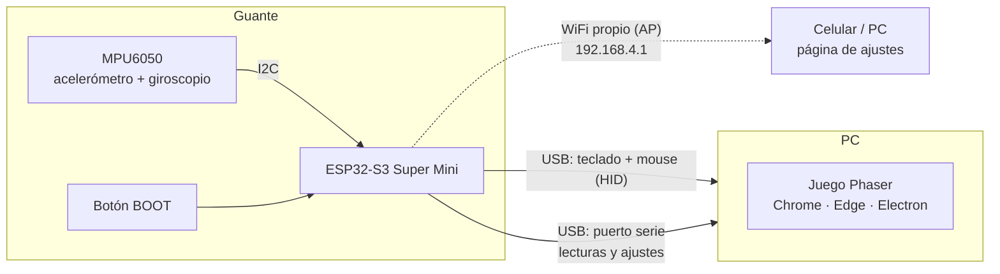
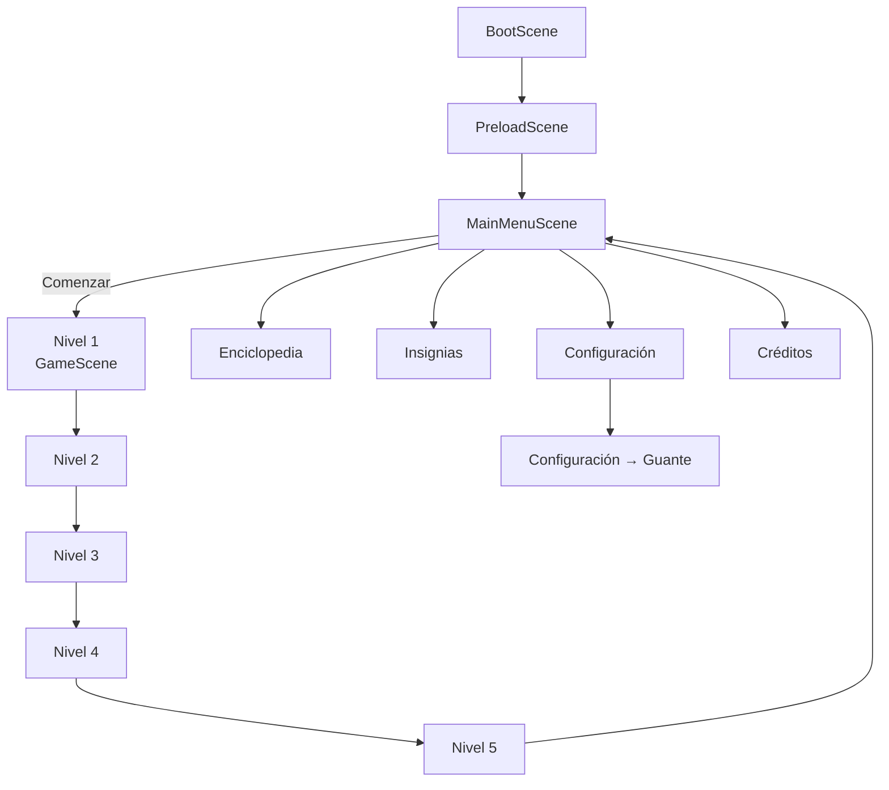
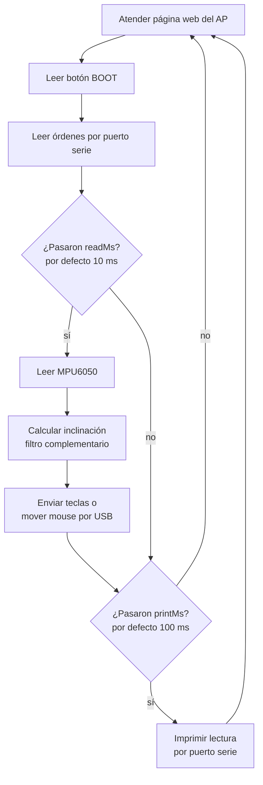

# El Misterio del Agujero Negro — Documentación del proyecto

Videojuego educativo sobre astronomía (agujeros negros, estrellas, constelaciones,
agujeros de gusano) que se puede jugar con teclado, mouse, pantalla táctil o con un
**guante con sensor de movimiento** construido con un ESP32-S3 y un MPU6050.

Este documento explica cómo funciona todo el proyecto: el juego, el guante, cómo se
comunican, cómo se ejecuta en cada plataforma y cómo resolver los problemas comunes.

---

## Índice

1. [Visión general](#1-visión-general)
2. [Tecnologías](#2-tecnologías)
3. [Estructura de carpetas](#3-estructura-de-carpetas)
4. [El juego](#4-el-juego)
5. [El guante](#5-el-guante)
6. [Comunicación guante ↔ juego](#6-comunicación-guante--juego)
7. [Cómo ejecutar el proyecto](#7-cómo-ejecutar-el-proyecto)
8. [Ramas del repositorio](#8-ramas-del-repositorio)
9. [Solución de problemas](#9-solución-de-problemas)
10. [Cómo extender el proyecto](#10-cómo-extender-el-proyecto)

---

## 1. Visión general



- El **guante** lee la inclinación de la mano y se presenta ante la PC como un
  **teclado y un mouse USB**. Por eso el juego (y cualquier otro programa) lo entiende
  sin instalar nada: inclinar la mano equivale a presionar flechas o mover el cursor.
- Por el mismo cable, el guante también envía sus **lecturas por puerto serie**. El juego
  las lee con **Web Serial** para mostrarlas en pantalla y para cambiar los ajustes del
  guante desde **Configuración → Guante**.
- El guante crea además su propia **red WiFi** con una página de ajustes, útil cuando no
  se está usando el juego.

---

## 2. Tecnologías

### Juego

| Tecnología | Para qué se usa |
|---|---|
| **TypeScript** | Lenguaje de todo el código del juego |
| **Phaser 3** (3.90) | Motor del juego: escenas, gráficos, física *arcade*, entrada de teclado/mouse/táctil |
| **Vite** (5) | Servidor de desarrollo y empaquetado para producción (`dist/`) |
| **Howler.js** | Música y efectos de sonido (con sintetizador Web Audio de respaldo) |
| **localStorage** | Guarda el progreso, insignias, volumen y ajustes de juego en el navegador |
| **Web Serial API** | Conexión del juego con el guante por USB (solo Chrome, Edge y Electron) |
| **Electron** | Versión de escritorio para Windows (`.exe`) |
| **Capacitor** (6) | Versión Android (APK) |
| **Docker + Nginx** | Publicación web (pensado para Dockploy) |
| **GitHub Actions** | Compila el APK automáticamente al subir a la rama `apk` |

### Guante

| Tecnología | Para qué se usa |
|---|---|
| **ESP32-S3 Super Mini** | Microcontrolador con WiFi y **USB nativo** (puede actuar como teclado/mouse) |
| **MPU6050** | Sensor de 6 ejes: acelerómetro (3 ejes) + giroscopio (3 ejes) |
| **PlatformIO + Arduino** (core ESP32 2.0.17) | Entorno y framework para programar el ESP32 |
| **TinyUSB** | Dispositivo USB compuesto: teclado + mouse + puerto serie |
| **WebServer / WiFi** (Arduino) | Punto de acceso WiFi y página de ajustes |
| **Preferences (NVS)** | Guarda los ajustes del guante en la memoria flash |

---

## 3. Estructura de carpetas

```
misterioAgujeroNegro/
├── src/
│   ├── main.ts                  Punto de entrada: configura Phaser, registra escenas,
│   │                            inicia el panel y la conexión del guante
│   ├── style.css
│   ├── scenes/                  Pantallas del juego (una clase por escena)
│   │   ├── BootScene.ts         Configuración inicial (tipo de control)
│   │   ├── PreloadScene.ts      Carga de imágenes y audio
│   │   ├── MainMenuScene.ts     Menú principal
│   │   ├── GameScene.ts         Nivel 1 — Agujero negro
│   │   ├── Level2Scene.ts       Nivel 2 — Estrella enana roja
│   │   ├── Level3Scene.ts       Nivel 3 — Constelaciones
│   │   ├── Level4Scene.ts       Nivel 4 — Agujero de gusano
│   │   ├── Level5Scene.ts       Nivel 5 — Nacimiento de un agujero negro
│   │   ├── EncyclopediaScene.ts Enciclopedia espacial
│   │   ├── BadgesScene.ts       Insignias
│   │   ├── ConfigScene.ts       Configuración (sonido, progreso, botón Guante)
│   │   ├── GloveConfigScene.ts  Configuración → Guante
│   │   └── CreditsScene.ts      Créditos
│   ├── sensor/
│   │   └── SensorHud.ts         Conexión con el guante (SensorService) y panel F5 (SensorHud)
│   ├── audio/AudioService.ts    Música y efectos
│   └── utils/
│       ├── StorageService.ts    Progreso, insignias y volumen
│       └── GameSettings.ts      Ajustes de juego (atracción del nivel 1)
├── public/assets/               Imágenes del menú, botones, certificados
├── hardware/guante-esp32/       Firmware del guante (proyecto PlatformIO)
│   ├── platformio.ini
│   ├── src/main.cpp
│   └── README.md                Guía rápida del guante
├── electron/                    Versión de escritorio
│   ├── main.cjs                 Ventana de Electron + permiso de puerto serie
│   └── pack.cjs                 Empaquetado a .exe
├── android/                     Proyecto Android generado por Capacitor
├── .github/workflows/build-apk.yml   Compilación automática del APK
├── Dockerfile, docker-compose.yml    Publicación web con Nginx
├── capacitor.config.ts, vite.config.ts, tsconfig.json, package.json
├── RESUMEN.md, EXPLICACION_CODIGO.md Documentos anteriores del equipo
└── DOCUMENTACION.md             Este documento
```

---

## 4. El juego

### 4.1 Arranque y flujo de escenas

`main.ts` crea el juego Phaser con un lienzo de **1280 × 576**, escalado con
`Phaser.Scale.FIT` y centrado, física **arcade sin gravedad global** (la gravedad de
los niveles se calcula a mano hacia el agujero negro o la estrella). Después de crear
el juego inicia `SensorHud` (panel F5) y `SensorService` (conexión con el guante).



- **Comenzar** abre el último nivel desbloqueado (`StorageService.getTargetScene()`),
  así no se empieza desde cero.
- Cada nivel tiene un botón **✕ SALIR** que vuelve al menú.

### 4.2 Niveles

| Nivel | Escena | Objetivo | Mecánica principal | Insignia |
|---|---|---|---|---|
| 1 — Agujero negro | `GameScene` | Recolectar 3 sondas (orbes amarillos) | Gravedad radial hacia el agujero negro; 3 vidas. Cada sonda abre una pregunta | Cazador de Agujeros |
| 2 — Enana roja | `Level2Scene` | Sobrevivir 15 s | Asteroides que aparecen y gravedad de la estrella roja; 2 preguntas | Navegante Experto |
| 3 — Constelaciones | `Level3Scene` | Unir las estrellas correctas en 45 s | Clic en una estrella y arrastrar hasta otra para trazar líneas; 2 preguntas | Astrónomo Mayor |
| 4 — Agujero de gusano | `Level4Scene` | Viajar 10 s esquivando anomalías | *Runner* vertical: la nave solo se mueve a izquierda/derecha; 2 preguntas | Viajero del Tiempo |
| 5 — Nacimiento | `Level5Scene` | Alinear los 3 haces de las estaciones Alfa, Beta y Gamma | Clic en cada estación para girarla hasta alinear su haz con la estrella; provoca la supernova; 3 preguntas | Investigador Agujeros |

**Gravedad del nivel 1.** En cada cuadro (`update()`, ~60 veces por segundo):

```
distancia = √(dx² + dy²)
si distancia < 50  → la nave cae en el horizonte de sucesos: pierde una vida
si distancia < 450 → aceleración = (18000 × atracción%) / distancia²   (dirigida al centro)
```

La **atracción** se ajusta en *Configuración → Guante → Atracción del agujero negro*
(10 % a 150 %, por defecto **50 %**).

**Preguntas.** Al responder bien se avanza; al responder mal se pierde progreso o se
repite la pregunta, según el nivel. Mientras hay una pregunta en pantalla
(`quizActive = true`) la física y los temporizadores se detienen.

### 4.3 Controles

`BootScene` define el tipo de control en el registro de Phaser (`controlType`):

| `controlType` | Cómo se maneja la nave |
|---|---|
| `pointer` (el valor actual) | Mientras se toca la pantalla o se mantiene el clic, la nave sigue al dedo/cursor. **Si no se está tocando, funcionan las flechas** del teclado o del guante |
| `keyboard` | Solo flechas |
| `virtual_buttons` | Botones táctiles dibujados en pantalla |

Teclas disponibles en cualquier momento:

| Tecla | Acción |
|---|---|
| ← → ↑ ↓ | Mover la nave (niveles 1, 2 y 4) |
| **P** | Pasar el nivel actual al instante (para pruebas y presentaciones). No funciona mientras hay una pregunta abierta |
| **F5** | Mostrar / ocultar el panel del sensor (ya no recarga la página; para recargar usar **Ctrl+F5**) |
| **F6** | Pausar / continuar las lecturas del panel |

### 4.4 Progreso, insignias y ajustes guardados

Todo se guarda en el `localStorage` del navegador (o de la app):

| Clave | Contenido | Archivo |
|---|---|---|
| `el_misterio_del_agujero_negro_progress` | Nivel actual, niveles desbloqueados, insignias, volumen de música y efectos | `StorageService.ts` |
| `el_misterio_del_agujero_negro_settings` | Atracción del nivel 1 (`gravityPercent`) | `GameSettings.ts` |

**Configuración → Reiniciar progreso** borra el progreso y las insignias.

### 4.5 Sonido

`AudioService` usa **Howler.js** para la música de fondo y los efectos (`click`,
`correct`, `incorrect`, `achievement`). Si los archivos de audio no existen, genera los
efectos con un **sintetizador Web Audio**, así el juego nunca queda mudo.

### 4.6 Otras pantallas

- **Enciclopedia:** fichas sobre qué es un agujero negro, horizonte de sucesos,
  singularidad, formación, espaguetización, tipos, distorsión del tiempo y agujeros de gusano.
- **Insignias:** muestra las 5 insignias y cuáles se han ganado.
- **Configuración:** silenciar, volumen de música y efectos, reiniciar progreso y el botón
  **🧤 GUANTE**.

---

## 5. El guante

### 5.1 Componentes

| Componente | Detalle |
|---|---|
| **ESP32-S3 Super Mini** | Chip ESP32-S3 (4 MB flash), USB-C nativo, WiFi, botón BOOT (GPIO 0), botón RST, LED en GPIO 48 |
| **MPU6050** (módulo GY-521) | Acelerómetro ±2/4/8/16 g y giroscopio ±250/500/1000/2000 °/s, bus I2C |
| Cables | 4 cables (5 si se conecta AD0) |
| Cable USB-C | Alimenta el guante y lo conecta a la PC |

### 5.2 Conexiones

| MPU6050 | ESP32-S3 Super Mini |
|---|---|
| VCC | **3V3** (no conectar a 5V) |
| GND | GND |
| SDA | **GPIO 8** |
| SCL | **GPIO 9** |
| AD0 | GND o sin conectar (dirección I2C **0x68**) |
| XDA, XCL, INT | Sin conectar |

> Si AD0 se conecta a 3V3, la dirección cambia a 0x69 y el firmware no encontrará el sensor.

### 5.3 Firmware: cómo funciona

Código: `hardware/guante-esp32/src/main.cpp`. El ciclo principal (`loop()`) hace, sin
detenerse:



#### a) Lectura del sensor

El firmware habla directamente con los registros del MPU6050 por I2C a 400 kHz, sin
librerías externas:

| Registro | Uso |
|---|---|
| `0x6B` PWR_MGMT_1 | Se escribe 0 para despertar el sensor |
| `0x1A` CONFIG | Filtro pasa bajos (260 Hz … 5 Hz) |
| `0x1B` GYRO_CONFIG | Rango del giroscopio |
| `0x1C` ACCEL_CONFIG | Rango del acelerómetro |
| `0x3B` … `0x48` | 14 bytes: aceleración X/Y/Z, temperatura, giro X/Y/Z |

Conversión a unidades reales:

```
aceleración (g)   = valor_crudo / (16384 / 2^rango)
giro (°/s)        = valor_crudo / (131 / 2^rango)
temperatura (°C)  = valor_crudo / 340 + 36.53
```

Si el sensor no responde, el firmware reintenta cada 2 segundos, así que se puede
conectar con el guante encendido.

#### b) Cálculo de la inclinación (filtro complementario)

- El **acelerómetro** da la inclinación respecto a la gravedad: es estable a largo plazo
  pero ruidoso con los movimientos bruscos.
- El **giroscopio** da la velocidad de giro: es suave y rápido pero se desvía con el tiempo.

El filtro complementario combina lo mejor de ambos:

```
roll_acel  = atan2(ay, az)                    (izquierda / derecha)
pitch_acel = atan2(−ax, √(ay² + az²))         (adelante / atrás)

ángulo = 0.96 × (ángulo + giro × dt) + 0.04 × ángulo_acel
```

Los ángulos se mantienen entre −180° y 180° para que no salten al dar la vuelta (el
sensor puede ir montado boca abajo).

#### c) Calibración

Al encender, el guante espera **1 segundo** a que la lectura se estabilice y toma esa
posición como **centro** (0°, 0°). Mientras tanto no envía teclas, para no mover nada
por accidente. Se puede recalibrar en cualquier momento desde el juego o la página del AP.

#### d) Modos de control

| Modo | Qué hace al inclinar | Uso recomendado |
|---|---|---|
| **Flechas** (1) | Presiona ← → ↑ ↓ | Niveles 1, 2 y 4 |
| **Mouse** (2) | Mueve el cursor; **BOOT** = clic izquierdo (mantener para arrastrar) | Nivel 3, nivel 5 y menús |
| **Desactivado** (0) | Nada (solo envía lecturas) | Mientras se programa o se usa la PC |

**Doble pulsación rápida de BOOT** (menos de 350 ms) alterna entre Flechas y Mouse.

**Modo flechas: presión proporcional.** Una tecla normal es "todo o nada", lo que hacía
la nave demasiado rápida con el guante. Por eso cada flecha se presiona **a pulsos** en
ciclos de 80 ms:

```
fuerza     = 0.3 + 0.7 × (inclinación − umbral) / 30°   (limitada entre 0.3 y 1)
presionada = fuerza × velocidad%   del tiempo de cada ciclo
```

- Justo al pasar el umbral la tecla está presionada el 30 % del tiempo multiplicado por la velocidad.
- Con 30° más de inclinación llega al 100 % multiplicado por la velocidad.
- Para soltar, la inclinación debe bajar del 70 % del umbral (**histéresis**), así la
  tecla no "tiembla" en el límite.

**Modo mouse: velocidad proporcional.**

```
si |inclinación| ≤ zona muerta  → el cursor no se mueve
si no → velocidad (px/s) = (|inclinación| − zona muerta) × velocidadCursor × 2
```

#### e) USB

Con `ARDUINO_USB_MODE=0` el ESP32 usa **TinyUSB** y aparece en Windows como un
dispositivo compuesto llamado **"Control MPU6050"** con:

- Teclado HID
- Mouse HID
- Puerto serie (CDC), por ejemplo `COM9`, a 115200 baudios

Al cambiar de modo, al desconectar el sensor o al apagar el modo, el firmware **suelta
todas las teclas** para que ninguna quede "pegada".

#### f) Punto de acceso WiFi y página de ajustes

| Dato | Valor |
|---|---|
| Red (SSID) | `ESP32S3-SuperMini` |
| Contraseña | `12345678` |
| Dirección | http://192.168.4.1 |
| Potencia | 8.5 dBm (la antena cerámica del Super Mini funciona mejor con baja potencia) |

Rutas del servidor web:

| Ruta | Método | Respuesta |
|---|---|---|
| `/` | GET | Página de ajustes |
| `/data` | GET | `{"ok":true,"roll":..,"pitch":..,"mode":1,"modeName":"Flechas"}` |
| `/config` | GET | Configuración actual en JSON |
| `/config` | POST | Guarda los ajustes enviados como formulario |
| `/calibrate` | POST | Toma la posición actual como centro |

#### g) Ajustes del guante

Se guardan en la memoria flash (NVS, espacio `ctrl`, clave `cfg`) y se conservan al
desconectar el guante. Si una nueva versión del firmware cambia la lista de ajustes,
vuelven a los valores por defecto.

| Ajuste | Clave | Rango | Por defecto |
|---|---|---|---|
| Modo | `mode` | 0 desactivado · 1 flechas · 2 mouse | 1 |
| Inclinación para activar una flecha | `keyAngle` | 3–60° | 15° |
| Velocidad en modo flechas | `keySpeed` | 10–100 % | 50 % |
| Velocidad del cursor | `mouseSpeed` | 1–30 | 10 |
| Zona muerta del cursor | `deadZone` | 0–30° | 4° |
| Invertir izquierda/derecha | `invertX` | 0 / 1 | 0 |
| Invertir adelante/atrás | `invertY` | 0 / 1 | 0 |
| Leer el sensor cada | `readMs` | 5–5000 ms | 10 ms |
| Imprimir por serie cada | `printMs` | 0–60000 ms (0 = no imprimir) | 100 ms |
| Rango del acelerómetro | `accel` | ±2/4/8/16 g | ±2 g |
| Rango del giroscopio | `gyro` | ±250/500/1000/2000 °/s | ±250 °/s |
| Filtro pasa bajos | `filter` | 260 … 5 Hz | 44 Hz |

Los tres últimos solo se cambian desde la página del AP.

---

## 6. Comunicación guante ↔ juego

### 6.1 Protocolo por puerto serie (115200 baudios, líneas de texto)

**Del guante al juego** — una lectura cada `printMs`:

```
Incl X:  12.3 Y:  -4.0 | Acel(g) X: 0.10 Y:-0.20 Z: 0.98 | Giro X:   1.0 Y:   0.5 Z:  -0.2 | Flechas
```

Si el sensor está desconectado, cada 2 s: `MPU6050 no detectado: revisa las conexiones`.

**Del juego al guante** — órdenes terminadas en salto de línea:

| Orden | Efecto | Respuesta |
|---|---|---|
| `GET` | Pide la configuración | `CFG:{"mode":1,"keySpeed":50,...}` |
| `SET clave=valor clave=valor ...` | Cambia y guarda ajustes (los valores fuera de rango se ajustan al límite) | `CFG:{...}` |
| `CAL` | Calibra el centro | `CFG:{...}` |

Ejemplo: `SET keySpeed=40 invertX=1`

### 6.2 Del lado del juego (`src/sensor/SensorHud.ts`)

**`SensorService`** maneja la conexión:

- `connect()` abre la ventana de Chrome para elegir la placa (filtrada por el fabricante
  Espressif, `0x303A`). Solo hace falta **una vez**: el navegador recuerda el permiso.
- Cada 2 segundos intenta reconectarse solo a una placa ya autorizada (por si se
  desconectó o el puerto estaba ocupado).
- Al recargar o cerrar la página libera el puerto para que la nueva página pueda abrirlo.
- Al conectar envía `GET` para recibir la configuración.
- `setConfig({...})` envía `SET`, `calibrate()` envía `CAL`.
- Avisa a quien esté escuchando (`onChange`) cada vez que llega una lectura, cambia la
  conexión o llega la configuración.

**`SensorHud`** es el panel que se abre con **F5**: muestra el estado, un nivel de burbuja
que se mueve con la mano, la inclinación, la aceleración, el giro y el modo. **F6** congela
los valores.

**`GloveConfigScene`** (Configuración → 🧤 GUANTE) es un formulario HTML encima del juego con:
conectar/desconectar, lectura en vivo, **Calibrar centro**, selector de modo, velocidad de
la nave, inclinación para moverse, velocidad y zona muerta del cursor, invertir ejes y la
**atracción del agujero negro** del nivel 1. Los controles del guante se habilitan cuando
llega su configuración.

### 6.3 En la app de escritorio (Electron)

Electron no muestra la ventana para elegir un puerto serie, así que `electron/main.cjs`:

- responde al evento `select-serial-port` eligiendo automáticamente la placa ESP32
  (fabricante `303a`),
- y concede el permiso `serial` a la página.

### 6.4 ¿Por qué dos canales?

| Canal | Ventaja |
|---|---|
| **Teclado/mouse USB** | Funciona en cualquier navegador, en Electron y en cualquier programa, sin permisos ni código especial |
| **Puerto serie** | Permite ver los datos del sensor y cambiar ajustes; requiere Chrome, Edge o Electron |

Si el puerto serie no está conectado, **el guante sigue controlando el juego** como
teclado/mouse; solo faltan el panel y los ajustes desde el juego.

---

## 7. Cómo ejecutar el proyecto

### 7.1 Requisitos

- **Node.js** 18 o superior (probado con 24) y npm.
- **Chrome o Edge** para usar el guante desde la versión web.
- Para el guante: **VS Code + extensión PlatformIO**.

### 7.2 Juego en modo desarrollo

```bash
npm install
npm run dev
```

Abrir http://localhost:5173. Cada cambio en el código recarga la página automáticamente.

### 7.3 Versión de producción (web)

```bash
npm run build      # revisa tipos con tsc y genera dist/
npm run preview    # sirve dist/ para probarlo
```

Con Docker (Nginx en el puerto 8080):

```bash
docker compose up -d --build
```

### 7.4 Versión de escritorio (Windows)

```bash
npm run desktop:start   # abrir con Electron (requiere haber hecho npm run build)
npm run desktop:build   # genera el .exe en dist_desktop/
```

### 7.5 Versión Android (APK)

Al subir cambios a la rama **`apk`**, GitHub Actions compila el APK automáticamente
(*Actions → Build Android APK → Artifacts*). Para hacerlo a mano:

```bash
npm run build
npx cap sync android
cd android && ./gradlew assembleDebug
```

> En Android el guante no se conecta por puerto serie (Web Serial no existe en el
> navegador de Android). El control con el dedo funciona igual que siempre.

### 7.6 Firmware del guante

1. Abrir la carpeta `hardware/guante-esp32` en VS Code con PlatformIO.
2. Conectar el ESP32-S3 por USB.
3. **Cerrar el juego** o pulsar *Desconectar* en Configuración → Guante (el juego ocupa el puerto).
4. Pulsar **Upload** (→) en la barra de PlatformIO.

La configuración (`platformio.ini`) ya incluye `use_1200bps_touch` y
`wait_for_upload_port`: PlatformIO reinicia la placa en modo de carga y espera a que
aparezca el nuevo puerto COM. Si aun así falla: mantener **BOOT**, pulsar **RST**,
soltar **BOOT** y subir de nuevo.

---

## 8. Ramas del repositorio

| Rama | Contenido |
|---|---|
| `main` | Primera versión completa con 4 niveles |
| `modificaciones` | `main` + controles táctiles y con mouse + Docker |
| `apk` | `modificaciones` + nivel 4 rediseñado, nivel 5, Android (Capacitor), Electron, nuevos íconos |
| `guante-sensor` | `apk` + guante (panel, Configuración → Guante, firmware), tecla P en todos los niveles, atracción configurable del nivel 1 y flechas activas en modo `pointer` |

---

## 9. Solución de problemas

| Problema | Causa probable | Solución |
|---|---|---|
| El panel dice "Sin conectar: ve a Configuración → Guante" | El navegador aún no tiene permiso para la placa | Configuración → 🧤 GUANTE → **Conectar** y elegir la placa |
| "Puerto ocupado, reintentando…" | Otro programa usa el puerto (monitor serie de PlatformIO, otra pestaña del juego) | Cerrar ese programa; el juego se conecta solo |
| "Conectado, pero sin datos" | `printMs` está en 0 | Poner *Imprimir por serial cada* en 30–100 ms (página del AP) |
| "MPU6050 no detectado" | Cables mal conectados, SDA/SCL cruzados, AD0 a 3V3 | Revisar las conexiones (sección 5.2) |
| La nave gira sola al conectar el guante | El guante no estaba quieto al encender, así que el centro quedó desviado | **Calibrar centro** con la mano en reposo |
| Las direcciones van al revés | El sensor está montado en otra orientación | Activar **Invertir izquierda/derecha** o **adelante/atrás** |
| La nave va demasiado rápida o lenta | Ajustes del modo flechas | Bajar o subir **Velocidad de la nave** e **Inclinación para moverse** |
| Las flechas no hacen nada en el nivel 3 o 5 | Esos niveles se juegan con el mouse | Cambiar a **modo Mouse** (doble pulsación de BOOT) |
| El cursor o las flechas se mueven mientras se usa la PC | El guante está en modo Flechas o Mouse | Poner el modo **Desactivado** |
| No se puede subir el firmware ("port is busy") | El juego tiene el puerto abierto | Cerrar el juego y volver a subir |
| La página no recarga con F5 | F5 abre el panel del sensor | Usar **Ctrl+F5** |
| La nave cae siempre en el agujero negro | Atracción muy alta | Bajar **Atracción del agujero negro** en Configuración → Guante |

---

## 10. Cómo extender el proyecto

### Agregar un nivel

1. Crear `src/scenes/Level6Scene.ts` copiando la estructura de un nivel existente
   (`create()`, `update()`, panel de preguntas, `completeLevel()`).
2. Registrar la escena en la lista `scene` de `src/main.ts`.
3. En `completeLevel()` del nivel anterior, llamar `this.scene.start('Level6Scene')` y
   actualizar `StorageService.setCurrentLevel(...)` y `getTargetScene()`.
4. Agregar la insignia en `BadgesScene.ts` y desbloquearla con `StorageService.unlockBadge('id')`.
5. Agregar el atajo **P** (ver cualquier nivel: `this.input.keyboard?.addKey('P')`).

### Usar el guante con control proporcional dentro de un nivel

`SensorService.latest` tiene la última lectura (`roll`, `pitch` en grados). Por ejemplo,
para girar la nave según cuánto se inclina la mano:

```ts
import { SensorService } from '../sensor/SensorHud';

const r = SensorService.latest;
if (r) {
  const giro = Phaser.Math.Clamp(r.roll / 45, -1, 1);  // −1 … 1
  this.probe.setAngularVelocity(giro * 200);
}
```

En ese caso conviene poner el guante en modo **Desactivado** (`SensorService.setConfig({ mode: 0 })`)
para que no envíe flechas al mismo tiempo, y subir la frecuencia de lecturas
(`SensorService.setConfig({ printMs: 20 })`).

### Agregar un ajuste al guante

1. **Firmware:** agregar el campo al final de `struct Settings` y su valor por defecto en
   `cfg`, incluirlo en `configJson()` y en `applySerialSetting()` (y en la página del AP si
   se quiere).
2. **Juego:** agregar la clave a `GloveConfig` en `SensorHud.ts` y un control en
   `GloveConfigScene.ts` con `data-cfg="clave"`; se envía y se muestra automáticamente.
