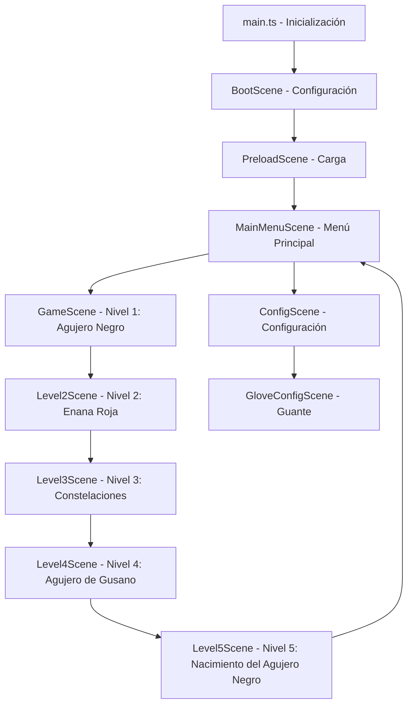

# Funcionamiento del Videojuego a Nivel de Código

Este documento explica de forma técnica y detallada cómo está estructurado el código de **"Misterio en el Agujero Negro"**, ideal para entender su arquitectura o explicarlo ante jueces.
Para la documentación completa del proyecto, incluido el guante con sensor, ver **[DOCUMENTACION.md](DOCUMENTACION.md)**.

---

## 1. Arquitectura General y Flujo de Datos

El juego utiliza una arquitectura basada en **Escenas (Scenes)** administradas por el motor **Phaser 3**. El flujo de ejecución es lineal a través de estas escenas:



---

## 2. El Punto de Entrada ([main.ts](src/main.ts))

Este archivo inicializa la instancia de Phaser mediante un objeto de configuración (`Phaser.Types.Core.GameConfig`):

*   **Físicas (Physics):** Configura el motor de física `arcade` sin gravedad global (`gravity: { x: 0, y: 0 }`). Esto se hace porque la gravedad del juego no atrae los objetos "hacia abajo", sino radialmente hacia el agujero negro o la estrella.
*   **Escalabilidad (Scale):** Usa el modo `Phaser.Scale.FIT` y `autoCenter` para que el lienzo (canvas) de **1280 × 576 píxeles** (proporción 20:9, pensada para celulares en horizontal) mantenga su proporción y se ajuste a cualquier pantalla de forma automática.
*   **Registro de Escenas:** Declara la lista ordenada de clases de escena que Phaser gestionará.
*   **Guante:** Después de crear el juego inicia `SensorHud` (panel con las lecturas del sensor) y `SensorService` (conexión con el guante por USB).

---

## 3. Lógica de Escenas Clave

### A. Configuración de Controles ([BootScene.ts](src/scenes/BootScene.ts))
En su ciclo de vida `create()` guarda en el registro de Phaser la configuración de la versión móvil y pasa directamente a `PreloadScene`:
*   `isMobile = true`
*   `controlType = 'pointer'`: mientras se toca la pantalla o se mantiene el clic, la nave sigue al dedo o al cursor.

En los niveles 1, 2 y 4, cuando no se está tocando la pantalla, se leen las **flechas del teclado** (que es también lo que envía el guante). El código conserva un tercer modo, `virtual_buttons` (botones táctiles dibujados en pantalla), que hoy no se activa.

### B. El Nivel del Agujero Negro ([GameScene.ts](src/scenes/GameScene.ts))
Es el núcleo de la física de gravedad simulada. En el método **`update()`** (que corre a 60 FPS):
1.  **Fuerza de Atracción (Gravedad Radial):**
    Calcula la distancia entre la nave y el centro del agujero negro usando la fórmula del teorema de Pitágoras:
    $$\text{distancia} = \sqrt{dx^2 + dy^2}$$
    Si la distancia es menor a 450 píxeles, aplica una aceleración vectorial hacia el centro:
    $$\text{aceleración} = \frac{\text{fuerza gravitatoria} \times \text{atracción}\%}{\text{distancia}^2}$$
    La fuerza base es 18000 y el porcentaje de atracción (50 % por defecto) se ajusta en Configuración → Guante. Se guarda con [GameSettings.ts](src/utils/GameSettings.ts).
2.  **Horizonte de Sucesos (Colisión):**
    Si la nave se acerca a menos de 50 píxeles, entra en el "límite de no retorno", restando una vida y reiniciando la posición de la nave.
3.  **Recolección de Sondas:**
    Usa el sistema de colisiones de Phaser (`physics.add.overlap`) para detectar cuándo la nave toca un orbe amarillo (`data_orb`). Al hacerlo, se pausa la física y se lanza la trivia.

### C. El Nivel de la Enana Roja ([Level2Scene.ts](src/scenes/Level2Scene.ts))
*   Hay que **sobrevivir 15 segundos**.
*   Un temporizador genera asteroides periódicamente (`spawnAsteroid()`), y la estrella roja atrae a la nave con la misma fórmula de gravedad que el nivel 1 (fuerza 10000).

### D. El Nivel de las Constelaciones ([Level3Scene.ts](src/scenes/Level3Scene.ts))
*   Hay **45 segundos** para unir las estrellas correctas.
*   Al presionar sobre una estrella se dibuja una línea que sigue al cursor; al soltar sobre otra estrella, se comprueba si la pareja está en `requiredConnections` (`[1,2], [2,3], [3,4], [4,5]`).

### E. El Nivel del Agujero de Gusano ([Level4Scene.ts](src/scenes/Level4Scene.ts))
Cambia la mecánica de simulación por un **Runner vertical**:
*   **Movimiento Restringido:** En el bucle de actualización, se fuerza la coordenada Y de la nave (`this.probe.y = height - 100`) y se desactiva la velocidad vertical, permitiendo únicamente el movimiento horizontal.
*   **Efecto de Velocidad:** Un conjunto de rectángulos (`speedLines`) caen de forma vertical continua y se reposicionan arriba al salir de la pantalla para simular movimiento hacia adelante.
*   **Generador de Anomalías (Spawning):** Un temporizador (`spawnTimer`) genera objetos `anomaly_tex` (círculos rojos) en coordenadas X aleatorias que caen a distintas velocidades físicas hacia abajo.
*   El viaje dura **10 segundos**, con una pregunta a mitad de camino y otra al final.

### F. El Nivel del Nacimiento del Agujero Negro ([Level5Scene.ts](src/scenes/Level5Scene.ts))
*   Tres estaciones deflectoras (**Alfa, Beta y Gamma**) rodean la estrella.
*   Cada clic gira una estación **45°** (`(angle + 45) % 360`). Cuando su ángulo coincide con `targetAngle`, su haz queda alineado.
*   Con los 3 haces alineados ocurre la supernova y comienzan las preguntas.

### G. Atajo para pasar de nivel
Todos los niveles registran la tecla **P** (`this.input.keyboard.addKey('P')`), que llama a `completeLevel()` si no hay una pregunta abierta. Sirve para pruebas y presentaciones.

---

## 4. Persistencia de Datos ([StorageService.ts](src/utils/StorageService.ts))

Este módulo utiliza la API nativa de JavaScript **`localStorage`** para que el navegador o la aplicación recuerden los datos del jugador entre sesiones. Todo el progreso se guarda como **un solo objeto JSON** bajo una clave:

```typescript
const STORAGE_KEY = 'el_misterio_del_agujero_negro_progress';

const DEFAULT_PROGRESS: PlayerProgress = {
  currentLevel: 1,
  unlockedLevels: 1,
  badges: [],
  musicVolume: 0.5,
  sfxVolume: 0.8
};

public static save(): void {
  localStorage.setItem(STORAGE_KEY, JSON.stringify(this.progress));
}
```

Al ganar un nivel (`setCurrentLevel`) o desbloquear una medalla (`unlockBadge`), esta clase actualiza el objeto y lo guarda localmente, evitando la necesidad de un servidor de bases de datos. `getTargetScene()` usa el nivel guardado para que **Comenzar** continúe donde se quedó el jugador.

Los ajustes de juego que no son progreso (la atracción del nivel 1) se guardan aparte, en `el_misterio_del_agujero_negro_settings`, con [GameSettings.ts](src/utils/GameSettings.ts).

---

## 5. El Entorno de Escritorio ([main.cjs](electron/main.cjs))

Para convertir la aplicación web en un programa `.exe`, **Electron** actúa como un navegador web incrustado (basado en Chromium) enfocado en una sola página:

*   **`createWindow()`**: Instancia una ventana con `BrowserWindow` en pantalla completa, con `resizable: true` para permitir cambiar su tamaño.
*   **`win.loadFile`**: Carga el archivo HTML estático precompilado por Vite en `dist/index.html`.
*   **Puerto serie del guante**: Electron no muestra la ventana para elegir un puerto, así que el evento `select-serial-port` elige automáticamente la placa ESP32 (fabricante `303a`) y se concede el permiso `serial`.

---

## 6. Conexión con el Guante ([SensorHud.ts](src/sensor/SensorHud.ts))

El guante (ESP32-S3 + MPU6050) se comunica con el juego por dos canales del mismo cable USB:

*   **Teclado y mouse USB**: el guante presiona flechas o mueve el cursor según la inclinación de la mano. El juego no necesita código especial para esto.
*   **Puerto serie (Web Serial API)**: `SensorService` abre el puerto a 115200 baudios, lee líneas como
    `Incl X: 12.3 Y: -4.0 | Acel(g) X: 0.10 ... | Flechas` y envía órdenes `GET`, `SET clave=valor` y `CAL` para leer y cambiar los ajustes del guante.

`SensorHud` dibuja el panel de lecturas (F5 / F6) y [GloveConfigScene.ts](src/scenes/GloveConfigScene.ts) es la pantalla Configuración → Guante. El firmware está en [hardware/guante-esp32](hardware/guante-esp32). Los detalles completos están en [DOCUMENTACION.md](DOCUMENTACION.md).
